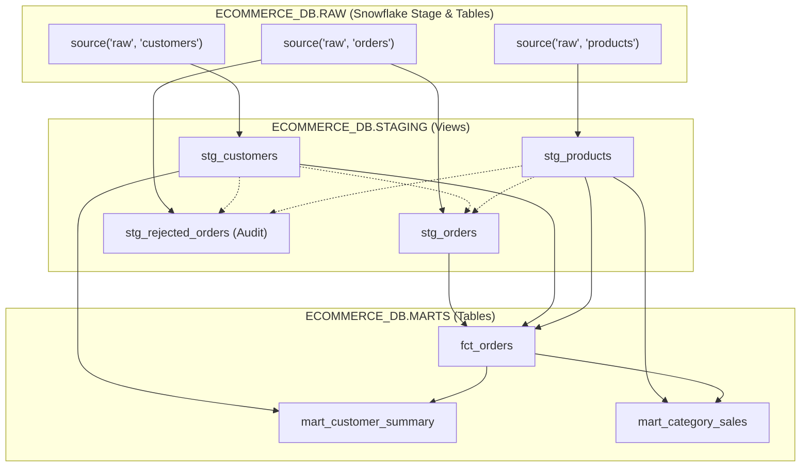

# E-Commerce Analytics Platform — Snowflake & dbt Implementation

A production-grade dimensional data warehouse and ELT analytics pipeline built with **Snowflake** and **dbt Core**, implemented in accordance with the **Samsung Innovation Campus / Machinfy Academy** data engineering assignment specifications.

---

## 1. Project Architecture & Pipeline Design

```
                  ┌──────────────────────┐
                  │   Raw Source CSVs    │
                  │ customers, products, │
                  │       orders         │
                  └──────────┬───────────┘
                             │
                             ▼ Ingestion via Python Stage PUT & COPY INTO
                  ┌──────────────────────┐
                  │ ECOMMERCE_DB.RAW     │
                  │ - CUSTOMERS (120)    │
                  │ - PRODUCTS (25)      │
                  │ - ORDERS (602)       │
                  └──────────┬───────────┘
                             │
                             ▼ dbt Staging (Views)
       ┌─────────────────────┴─────────────────────────┐
       ▼                                               ▼
┌─────────────────────────┐               ┌─────────────────────────┐
│ ECOMMERCE_DB.STAGING    │               │ ECOMMERCE_DB.STAGING    │
│ - stg_customers (120)   │               │ - stg_rejected_orders   │
│ - stg_products (25)     │               │   (7 invalid rows audit)│
│ - stg_orders (595)      │               └─────────────────────────┘
└──────────┬──────────────┘
           │
           ▼ dbt Core Transformation (Tables)
┌──────────────────────────────────────────────┐
│ ECOMMERCE_DB.MARTS                           │
│ - fct_orders (595 rows)                      │
│   (Grain: 1 row per order, joins dimensions) │
└──────────┬───────────────────────────────────┘
           │
           ├───────────────────────────────────┐
           ▼                                   ▼
┌─────────────────────────┐       ┌─────────────────────────┐
│ ECOMMERCE_DB.MARTS      │       │ ECOMMERCE_DB.MARTS      │
│ - mart_customer_summary │       │ - mart_category_sales   │
│   (120 customers)       │       │   (5 product categories)│
└─────────────────────────┘       └─────────────────────────┘
```

---

## 2. Cleaned Repository Structure

```text
/home/syd/Desktop/snowflake/
├── .env.example                     # Onboarding template for credentials
├── .env                             # Private local environment credentials (gitignored)
├── .gitignore                       # Strict git exclusion rules
├── ingest_data.py                   # Modular CSV ingestion script (PUT & COPY INTO)
├── verify_pipeline.py               # Independent cross-model financial reconciliation
├── run_pipeline.sh                  # Canonical master entry point orchestrating pipeline
├── setup_snowflake.sql              # Standalone DDL & RBAC setup script for Snowflake
├── README.md                        # Canonical project documentation
├── data/                            # Authoritative source CSV files
│   ├── customers.csv                # 120 customer records
│   ├── products.csv                 # 25 product catalog items
│   └── orders.csv                   # 602 raw order transactions
└── ecommerce_dbt/                   # Core dbt project
    ├── dbt_project.yml              # dbt project configurations and schema settings
    ├── profiles.yml                 # dbt connection profile parameterized by env vars
    ├── macros/
    │   └── generate_schema_name.sql # Custom schema macro resolving STAGING and MARTS
    ├── models/
    │   ├── sources.yml              # Raw source table definitions
    │   ├── staging/
    │   │   ├── stg_customers.sql    # Customer dimension staging view
    │   │   ├── stg_products.sql     # Product catalog staging view
    │   │   ├── stg_orders.sql       # Deduplicated and standardized orders staging view
    │   │   ├── stg_rejected_orders.sql # Audit log isolating corrupt/rejected records
    │   │   └── staging.yml          # Staging documentation & 28 data quality tests
    │   └── marts/
    │       ├── fct_orders.sql       # Central fact table with revenue recognition
    │       ├── mart_customer_summary.sql # Customer lifetime volume and spending
    │       ├── mart_category_sales.sql   # Sales volume and revenue by product category
    │       └── marts.yml            # Marts documentation & 20 data quality tests
    └── tests/
        ├── assert_completed_revenue_non_negative.sql # Custom test: completed revenue >= 0
        ├── assert_pending_cancelled_revenue_zero.sql # Custom test: pending/cancelled = $0
        ├── assert_positive_order_quantities.sql     # Custom test: order quantity > 0
        ├── assert_positive_product_prices.sql       # Custom test: product price > 0
        └── assert_mart_revenue_reconciles_fact.sql   # Custom test: cross-model balance
```

---

## 3. Data Cleaning Findings & Business Logic

### Raw Data Anomalies Addressed:
1. **Duplicates**: `order_id` 21 and 101 appeared twice in `orders.csv`. Deduplicated via `ROW_NUMBER() OVER (PARTITION BY order_id ORDER BY order_date) = 1`.
2. **Missing Quantities**: `order_id` 37 and 188 had blank quantities. Filtered from clean staging and logged to `stg_rejected_orders`.
3. **Negative Quantity**: `order_id` 415 had quantity `-2.0`. Excluded to enforce positive quantity constraint.
4. **Orphan Foreign Keys**: `order_id` 94 referenced missing customer `9999`; `order_id` 271 referenced missing product `9999`. Filtered to enforce referential integrity.
5. **Status Standardization**:
   - `completed` and `shipped` &rarr; mapped to `completed` (representing fulfilled orders where goods were delivered and revenue is recognized).
   - `pending` &rarr; `pending`.
   - `cancelled` &rarr; `cancelled`.
   - Raw status preserved as `raw_order_status` in both `stg_orders` and `fct_orders`.

### Financial Revenue Recognition Rules:
- **Gross Revenue**: `quantity * unit_price` (contractual order value).
- **Recognized Revenue**:
  - `completed` orders: `quantity * unit_price` (earned revenue).
  - `pending` orders: `$0.00` (unearned).
  - `cancelled` orders: `$0.00` (voided).

### Perfect Financial Balance:
$$\sum \text{fct\_orders} = \sum \text{mart\_category\_sales} = \sum \text{mart\_customer\_summary} = \$7,709,900.00$$

Cross-model revenue delta is **$0.0000** down to the penny.

---

## 4. Execution & Setup Instructions

### Prerequisites
- Python 3.11+
- Snowflake Account with `ACCOUNTADMIN` (or role with access to `ECOMMERCE_DB` and `ECOMMERCE_WH`).

### Step 1: Configure Credentials Securely
Edit the gitignored `.env` file at the repository root:

```ini
SNOWFLAKE_ACCOUNT=UTIUWFL-VV06936
SNOWFLAKE_USER=SAYED.ELMASRI2004@GMAIL.COM
SNOWFLAKE_PASSWORD=YourPasswordHere
SNOWFLAKE_ROLE=ACCOUNTADMIN
SNOWFLAKE_WAREHOUSE=ECOMMERCE_WH
SNOWFLAKE_DATABASE=ECOMMERCE_DB
SNOWFLAKE_SCHEMA=PUBLIC
```

*(Zero secrets are stored in `profiles.yml` or git-tracked files).*

### Step 2: Canonical End-to-End Execution
Run the master orchestration script from the repository root:

```bash
./run_pipeline.sh
```

This single entry-point script automatically:
1. Validates connection via `dbt debug`.
2. Ingests all 3 CSVs into `ECOMMERCE_DB.RAW.*` via stage PUT & COPY INTO.
3. Compiles and materializes 4 staging views and 3 analytics mart tables via `dbt run`.
4. Executes all 53 automated generic and singular tests via `dbt test`.
5. Compiles documentation via `dbt docs generate`.
6. Executes independent financial reconciliation via `verify_pipeline.py`.

### Step 3: Inspect Lineage Graph (DAG)
To inspect the interactive directed acyclic graph (DAG) and data dictionary generated by dbt:

```bash
cd ecommerce_dbt
../.venv/bin/dbt docs serve --port 8080 --profiles-dir .
```
Navigate to `http://localhost:8080` in your browser and click the **Lineage Graph** icon in the bottom right corner.



---

## 5. Rerunning the Pipeline When New Orders Arrive

In a production environment, new order events arrive continuously or in scheduled micro-batches. Here is how this architecture handles pipeline reruns:

### 1. Ingestion of New Raw Order Files
- **Internal / External Stage Ingestion**: New batch files (e.g. `orders_YYYYMMDD_HHMM.csv`) are uploaded to Snowflake stage `@ECOMMERCE_DB.RAW.CSV_STAGE`.
- **COPY INTO with Metadata Tracking**: Snowflake's `COPY INTO` command maintains a 64-day load history preventing duplicate ingestion of already-processed files. Alternatively, **Snowpipe** can be configured with an Amazon S3 / Azure Blob SNS event notification for continuous micro-batch loading into `RAW.ORDERS`.

### 2. Idempotency & Conflict Handling in Staging
- **Automatic Deduplication**: If an order arrives multiple times or updates are resent, `stg_orders` applies `ROW_NUMBER() OVER (PARTITION BY order_id ORDER BY order_date ASC)` to guarantee only one record per `order_id` proceeds to downstream layers.
- **Corrupt Order Isolation**: Any invalid, non-numeric, negative, or orphan foreign key orders are automatically filtered to `stg_rejected_orders` without failing the pipeline.

### 3. Transformation Execution Strategies
- **Full Refresh Batch Mode (Default)**:
  Running `./run_pipeline.sh` executes `dbt run`, which materializes views in `STAGING` and full-refreshes tables in `MARTS`. For datasets under tens of millions of rows, full rebuilds guarantee 100% data consistency and simplified state management.
- **Incremental Modeling Strategy (`is_incremental()`)**:
  For high-volume production tables, `fct_orders` can be configured as `materialized='incremental'` with `unique_key='order_id'`:
  ```sql
  {{ config(materialized='incremental', unique_key='order_id') }}
  ...
  
    where order_date >= (select max(order_date) from {{ this }})
  
  ```
  This processes only orders placed or modified since the last pipeline run, drastically minimizing Snowflake compute credits.
- **Marts Refresh**: Downstream aggregate marts (`mart_customer_summary`, `mart_category_sales`) are rebuilt from the fact table, ensuring aggregated lifetime totals remain 100% accurate.

### 4. Orchestration & Automated Scheduling
The pipeline entry point (`./run_pipeline.sh`) is modular and can be triggered via:
- **Cron Job**: e.g., daily at 2:00 AM (`0 2 * * * /home/syd/Desktop/snowflake/run_pipeline.sh`).
- **Orchestrator**: Apache Airflow / Dagster / Prefect DAG triggering ingestion & dbt jobs upon arrival of new upstream source partitions.
- **Snowflake Native**: Snowflake Tasks & Streams (`CREATE TASK rerun_pipeline ... AFTER orders_stream`).

---

## 6. Verification Evidence Summary

- **Ingested Raw Rows**: `CUSTOMERS`: 120 | `PRODUCTS`: 25 | `ORDERS`: 602
- **Cleaned Fact Rows**: `FCT_ORDERS`: 595
- **Rejected Order Rows Audited**: `STG_REJECTED_ORDERS`: 7
- **dbt Test Suite**: **53 / 53 PASSED** (0 failed, 0 warnings, 0 errors)
  - 48 Generic schema tests (unique, not_null, accepted_values, relationships)
  - 5 Singular business tests (completed revenue non-negative, pending/cancelled revenue zero, positive product prices, positive order quantities, cross-mart revenue reconciliation)
- **Total Recognized Revenue**: **$7,709,900.00** across all models ($0.0000 delta)

